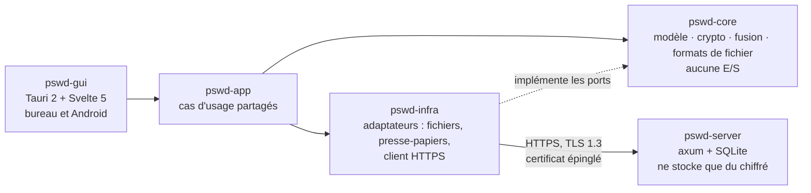

<p align="center">
  
</p>

<h1 align="center">PSWD Master</h1>

<p align="center">
  <strong>Un gestionnaire de mots de passe local-first, chiffré de bout en bout, écrit en Rust.</strong><br>
  Bureau (Windows, Linux, macOS) et Android, avec un serveur de synchro auto-hébergé facultatif.
</p>

<p align="center">
  <a href="https://github.com/ArthurFontaine84/PSWD_Master/actions/workflows/ci.yml"></a>
  
  
  
  
</p>

<p align="center"><a href="README.md">🇬🇧 English version</a></p>

---

## Pourquoi ce projet

La plupart des gestionnaires de mots de passe gardent votre coffre sur les serveurs d'une entreprise. Je voulais un outil qui ne dépende de personne : les données vivent sur vos appareils et, si vous voulez les synchroniser, sur un petit serveur installé chez vous. Le serveur ne stocke que des fichiers chiffrés et ne détient aucune clé.

Je l'ai conçu de bout en bout : d'abord une spécification écrite ([`docs/SPEC.md`](../docs/SPEC.md)), puis une bibliothèque cœur, une application multiplateforme et un serveur de synchro.

## Fonctionnalités

- **Coffres chiffrés** : un mot de passe maître par coffre, plus une clé de récupération affichée une seule fois à la création.
- **Identifiants et notes sécurisées**, avec tags, recherche, générateur de mots de passe et historique des versions de chaque entrée (10 versions).
- **Presse-papiers sécurisé** : effacé après 20 s et exclu de l'historique quand la plateforme le permet (Windows, Android 13+, KDE).
- **Verrouillage automatique** après inactivité ; sur mobile, l'écran est masqué dans les applications récentes et les captures sont bloquées.
- **Import CSV** et **sauvegardes chiffrées** (fichiers `.pswd`) restaurables sur n'importe quel appareil.
- **Synchro auto-hébergée facultative** : plusieurs appareils par compte, coffres familiaux partagés, panneau d'administration, fusion sans conflit qui fonctionne hors ligne. La synchro se fait pour l'instant sur le réseau de la maison ; l'accès depuis l'extérieur arrivera dans une prochaine version.
- **Entièrement utilisable hors ligne** : ni compte, ni abonnement, ni télémétrie.

## Architecture

Un workspace Cargo en architecture hexagonale (ports et adaptateurs). Le cœur ne fait aucune E/S : la même logique tourne sur le bureau et sur mobile.



| Crate | Rôle |
|---|---|
| `pswd-core` | Modèle de données, cryptographie, algorithme de fusion, formats de fichier binaires, parseur CSV, ports (traits). Logique pure, compilable pour mobile. |
| `pswd-infra` | Adaptateurs : stockage de fichiers atomique, presse-papiers sécurisé, configuration, client HTTPS du serveur. |
| `pswd-app` | Cas d'usage, indépendants de l'interface (créer, déverrouiller, sauvegarder, restaurer, importer, synchroniser…). |
| `pswd-gui` | L'application **PSWD Master** : backend Rust (commandes Tauri, session) et interface Svelte 5 + TypeScript. |
| `pswd-server` | Serveur de synchro auto-hébergé : API REST, comptes et appareils, coffres versionnés, paquet Debian et image Docker. |

## Sécurité

- **Chiffrement** : chaque coffre a une clé aléatoire de 256 bits qui chiffre son contenu en **XChaCha20-Poly1305**. Cette clé est enveloppée par le mot de passe maître (**Argon2id**, 64 Mio, 3 itérations) et par la clé de récupération (HKDF-SHA256). Changer de mot de passe maître refait l'enveloppe sans rechiffrer le coffre.
- **Serveur sans connaissance** : le serveur stocke des fichiers chiffrés opaques. Le transport est en TLS 1.3 seulement, et les clients épinglent l'empreinte SHA-256 du certificat du serveur.
- **Hygiène mémoire** : les secrets vivent dans des types effacés à la libération et n'apparaissent jamais dans les logs, `Debug` ni les messages d'erreur.
- **Exposition minimale à la webview** : la clé du coffre et les données déchiffrées restent en Rust ; l'interface ne reçoit un mot de passe que si l'utilisateur demande à le voir. CSP stricte, capacités Tauri limitées aux commandes de l'application.
- **Entrées hostiles** : chaque fichier est entièrement découpé et validé avant toute dérivation de clé ; les paramètres Argon2 lus dans un fichier sont bornés.
- **Fusion sans perte** : une fonction de fusion pure et déterministe, dont la commutativité, l'associativité et l'idempotence sont vérifiées par des tests de propriétés.

Le modèle de menace, les limites connues et la façon de signaler une faille sont dans [`SECURITY.md`](SECURITY.md).

## Qualité et tests

| | |
|---|---|
| **690 tests Rust**, **plus de 290 tests TypeScript** | unitaires, d'intégration (client contre un vrai serveur local) et de composants (Testing Library) |
| **100 % des lignes et des branches** de `pswd-core` | imposé avec `cargo llvm-cov` ; la logique de l'interface est tenue à 100 % des lignes par Vitest |
| **Tests de mutation** | `cargo mutants` sur `pswd-core` : aucun mutant survivant |
| **Fuzzing** | 4 cibles `cargo fuzz` : fichier de coffre, contenu déchiffré, sauvegarde, import CSV |
| **Tests de propriétés** | `proptest` pour les règles de fusion, les allers-retours de la crypto et l'import CSV |
| **Lint strict** | `clippy::pedantic` avec les avertissements en erreurs, `unwrap`/`expect` refusés hors des tests, aucun code `unsafe` (interdit à la compilation dans 4 crates sur 5) |
| **Chaîne d'approvisionnement** | `cargo deny` vérifie failles, licences et sources ; dépendances de l'interface figées |

L'intégration continue lance le formatage, Clippy, les tests Rust et TypeScript et `cargo deny` à chaque push. La liste complète des vérifications est dans [`docs/DEVELOPPEMENT.md`](../docs/DEVELOPPEMENT.md).

## Technologies

**Rust** (édition 2024) · Tauri 2 · axum · tokio · rustls · rusqlite · argon2 · chacha20poly1305 · serde
**Interface** : Svelte 5 · TypeScript · Vite · Vitest · Testing Library · ESLint
**Outillage** : cargo-nextest · cargo-llvm-cov · cargo-mutants · cargo-fuzz · cargo-deny · cargo-deb · Docker

## Démarrage

Prérequis : Rust 1.99 ou plus récent, Node.js 22.12 ou plus récent et les [prérequis de Tauri](https://tauri.app/start/prerequisites/) de votre système.

```sh
git clone https://github.com/ArthurFontaine84/PSWD_Master.git
cd PSWD_Master

# Lancer les tests
cargo test --workspace

# Application de bureau
cd crates/pswd-gui
npm ci
npm run tauri dev
```

Guides détaillés : [installation et builds](../docs/INSTALLATION.md), [guide d'utilisation](../docs/GUIDE.md) et [serveur maison](../docs/SERVEUR.md).

## Avancement

| Étape | État |
|---|---|
| Coffres locaux et bibliothèque cœur | ✅ Terminé |
| Application de bureau (Windows, Linux, macOS) et Android | ✅ Terminé |
| Serveur de synchro auto-hébergé (réseau de la maison), coffres partagés, administration | ✅ Terminé, v1.0.0 |
| Accès au serveur depuis l'extérieur de la maison | ⏳ Prochaine version |
| Build iOS | ⏳ Prévu (nécessite un Mac) |
| Interface en anglais, déverrouillage biométrique, fichier-clé | 💡 Points d'extension déjà en place |

## Auteur

**Arthur Fontaine**, développeur logiciel à Montréal.
[LinkedIn](https://www.linkedin.com/in/arthur-fontaine-dev) · [GitHub](https://github.com/ArthurFontaine84)
