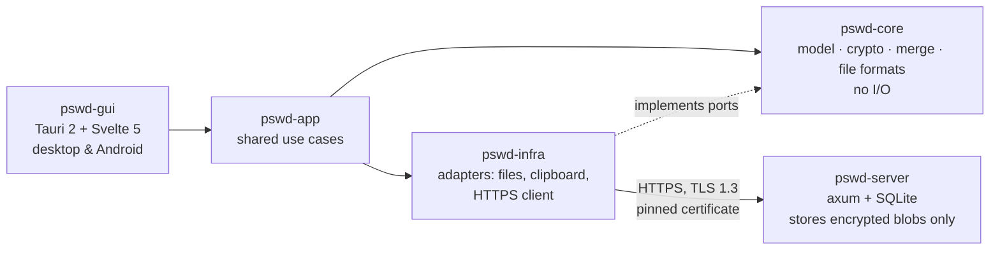

<p align="center">
  
</p>

<h1 align="center">PSWD Master</h1>

<p align="center">
  <strong>A local-first, end-to-end encrypted password manager, built in Rust.</strong><br>
  Desktop (Windows, Linux, macOS) and Android, with an optional self-hosted sync server.
</p>

<p align="center">
  <a href="https://github.com/ArthurFontaine84/PSWD_Master/actions/workflows/ci.yml"></a>
  
  
  
  
</p>

<p align="center"><a href="README.fr.md">🇫🇷 Version française</a></p>

---

## Why this project

Most password managers keep your vault on a company's servers. I wanted one that depends on no one: the data lives on your own devices and, if you want sync, on a small server you run at home. The server only ever stores encrypted blobs and never holds a key.

I designed it end to end: a written specification first ([`docs/SPEC.md`](../docs/SPEC.md)), then a core library, a cross-platform app and a sync server.

## Features

- **Encrypted vaults**: one master password per vault, plus a recovery key shown once at creation.
- **Logins and secure notes**, with tags, search, a password generator and a version history per entry (10 versions).
- **Secure clipboard**: cleared after 20 s and excluded from clipboard history where the platform allows it (Windows, Android 13+, KDE).
- **Auto-lock** after inactivity; on mobile, the screen is hidden from the app switcher and screenshots are blocked.
- **CSV import** and **encrypted backups** (`.pswd` files) that restore on any device.
- **Optional self-hosted sync**: multiple devices per account, shared family vaults, an admin panel, offline-first conflict-free merging. Sync currently works on the home network; remote access is planned for a future release.
- **Works fully offline**: no account, no subscription, no telemetry.

## Architecture

A Cargo workspace following a hexagonal (ports and adapters) architecture. The core has no I/O, so the same logic runs on desktop and mobile.



| Crate | Role |
|---|---|
| `pswd-core` | Data model, cryptography, merge algorithm, binary file formats, CSV parser, ports (traits). Pure logic, compiles for mobile. |
| `pswd-infra` | Adapters: atomic file storage, secure system clipboard, configuration, HTTPS client for the server. |
| `pswd-app` | Use cases, independent of the interface (create, unlock, back up, restore, import, sync…). |
| `pswd-gui` | The **PSWD Master** app: Rust backend (Tauri commands, session) and a Svelte 5 + TypeScript interface. |
| `pswd-server` | Self-hosted sync server: REST API, accounts and devices, versioned vaults, Debian package and Docker image. |

## Security design

- **Encryption**: each vault has a random 256-bit key that encrypts its contents with **XChaCha20-Poly1305**. That key is wrapped by the master password (**Argon2id**, 64 MiB, 3 iterations) and by the recovery key (HKDF-SHA256). Changing the master password re-wraps the key without re-encrypting the vault.
- **Zero-knowledge server**: the server stores opaque encrypted files. Transport is TLS 1.3 only, and clients pin the server certificate's SHA-256 fingerprint.
- **Memory hygiene**: secrets live in types that are zeroed on drop, and never reach logs, `Debug` output or error messages.
- **Minimal exposure to the web view**: the vault key and decrypted data stay in Rust; the interface receives a password only when the user explicitly asks to see it. Strict CSP, and Tauri capabilities limited to the app's own commands.
- **Hostile input**: every file is fully parsed and validated before any key derivation; Argon2 parameters read from a file are bounded.
- **Merge without data loss**: a pure, deterministic merge function, checked to be commutative, associative and idempotent with property-based tests.

The threat model, known limitations and how to report a vulnerability are in [`SECURITY.md`](SECURITY.md).

## Quality and testing

| | |
|---|---|
| **690 Rust tests**, **290+ TypeScript tests** | unit, integration (client against a real local server) and component tests (Testing Library) |
| **100 % line and branch coverage** of `pswd-core` | enforced with `cargo llvm-cov`; the interface logic is held to 100 % of lines by Vitest |
| **Mutation testing** | `cargo mutants` on `pswd-core`: no surviving mutant |
| **Fuzzing** | 4 `cargo fuzz` targets: vault file, decrypted payload, backup file, CSV import |
| **Property-based tests** | `proptest` for the merge rules, crypto round trips and CSV import |
| **Strict linting** | `clippy::pedantic` with warnings as errors, `unwrap`/`expect` denied outside tests, no `unsafe` code (forbidden at compile time in 4 of 5 crates) |
| **Supply chain** | `cargo deny` checks advisories, licenses and sources; frontend dependencies pinned |

Continuous integration runs formatting, Clippy, the Rust and TypeScript test suites and `cargo deny` on every push. The full checklist is in [`docs/DEVELOPPEMENT.md`](../docs/DEVELOPPEMENT.md).

## Tech stack

**Rust** (2024 edition) · Tauri 2 · axum · tokio · rustls · rusqlite · argon2 · chacha20poly1305 · serde
**Frontend**: Svelte 5 · TypeScript · Vite · Vitest · Testing Library · ESLint
**Tooling**: cargo-nextest · cargo-llvm-cov · cargo-mutants · cargo-fuzz · cargo-deny · cargo-deb · Docker

## Getting started

Requirements: Rust 1.99+, Node.js 22.12+ and the [Tauri prerequisites](https://tauri.app/start/prerequisites/) for your platform.

```sh
git clone https://github.com/ArthurFontaine84/PSWD_Master.git
cd PSWD_Master

# Run the test suite
cargo test --workspace

# Desktop app
cd crates/pswd-gui
npm ci
npm run tauri dev
```

Detailed guides (in French): [installation and builds](../docs/INSTALLATION.md), [user guide](../docs/GUIDE.md) and [home server](../docs/SERVEUR.md).

## Project status

| Milestone | Status |
|---|---|
| Local vaults and core library | ✅ Done |
| Desktop app (Windows, Linux, macOS) and Android | ✅ Done |
| Self-hosted sync server (home network), shared vaults, admin panel | ✅ Done, v1.0.0 |
| Remote access to the server from outside the home | ⏳ Next release |
| iOS build | ⏳ Planned (needs a Mac) |
| English interface, biometric unlock, key file | 💡 Extension points already in place |

The project documentation, specification and commit history are written in French.

## Author

**Arthur Fontaine**, software developer based in Montréal.
[LinkedIn](https://www.linkedin.com/in/arthur-fontaine-dev) · [GitHub](https://github.com/ArthurFontaine84)
